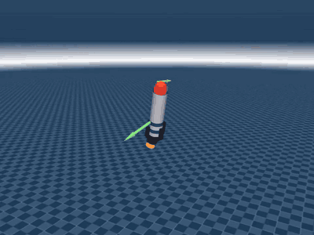
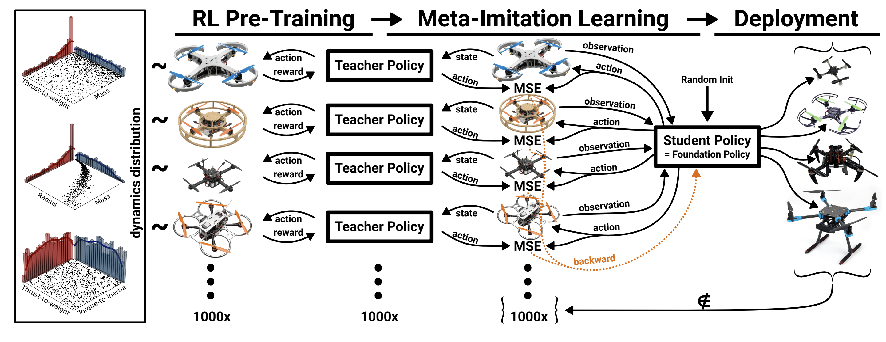

# miniDropper RL

> **Work in progress.** The pipeline runs end to end, but only small test trainings have been done so far.

[](docs/media/minidropper_flight.mp4)

*Nominal PPO teacher following random velocity and yaw commands. Click for the MP4. Record your own with `python -m minidropper.evaluate --policy <ckpt> --mode video`.*

### Roadmap

- [x] MuJoCo model of the miniDropper (primitive shapes), with EDF, servo and tether dynamics
- [x] Vehicle config sampler (1000 train + 100 test configs)
- [x] Single PPO teacher on the nominal rocket
- [x] Multi-teacher PPO (one teacher per config)
- [x] DAgger distillation into a GRU student
- [x] Domain-randomisation baselines
- [x] Evaluator: GUI, batch diagnostics and MP4 recording
- [ ] Full-scale training (1000 teachers + student) and comparison against the baselines
- [ ] Real CAD model of the drone in the simulation

---

Advanced RL techniques to control a thrust-vectoring rocket.
The repo asks whether it is feasible to land a real 2 m nitrous oxide / ethanol rocket with RL.
For fast iteration, the problem is first reduced to a "miniDropper": a tethered 6 cm x 20 cm
tube with two coaxial counter-rotating EDFs and a 2-DoF gimballed nozzle.

The training recipe follows [RAPTOR](https://github.com/rl-tools/raptor):



*The RAPTOR method. Figure 1(B) from J. Eschmann, D. Albani, G. Loianno, "RAPTOR: A Foundation Policy for Quadrotor Control", [arXiv:2509.11481](https://arxiv.org/abs/2509.11481), 2025.*

1. Sample many vehicle configs.
2. Train one specialised teacher per fixed config.
3. Distil all teachers into one recurrent (GRU) student with DAgger. The student must adapt
   in-context.

This replaces plain domain randomisation, which is kept as a baseline to test the hypothesis
that specialised teachers distilled into a recurrent student generalise better.

Framework: same as [ArcDrone](https://github.com/jrmch12/arcdrone). That means MuJoCo Playground `MjxEnv` (MJX physics), Brax PPO,
Hydra configs, `brax.io.model` pickles and optional WandB. When a brax / playground file must
change, it is copied into this repo and imported from here instead of being forked:
- [`teachers/training/ppo_train.py`](src/minidropper/teachers/training/ppo_train.py) is brax
  PPO patched for jax 0.11.
- [`teachers/training/multi_ppo.py`](src/minidropper/teachers/training/multi_ppo.py) is the
  multi-teacher PPO.
- [`task/wrapper.py`](src/minidropper/task/wrapper.py) holds the per-config vmap wrapper and
  the fixed auto-reset wrapper.

Plan and design notes: [docs/plans/2026-09-26_raptor_recipe_minidropper.md](docs/plans/2026-09-26_raptor_recipe_minidropper.md).

## Task

- **Actions** (4, in [-1, 1]): the top EDF throttle, the bottom EDF throttle, the nozzle
  pitch servo and the nozzle roll servo.
- **Student observation** (27, state-estimator only, no position):
  - world velocity, and velocity minus its reference
  - rotation matrix
  - body rates
  - accelerometer
  - sin/cos of the yaw error
  - the previous action
- **Teacher observation**: the student observation plus EDF speeds and servo angles.
- **Commands**: a velocity reference (3D) and an absolute yaw (bounded, so the tether does
  not twist).

## Layout

```
assets/minidropper/          rocket.xml (primitives, CAD later) + scene.xml
data/params/v1.npz           1000 train + 100 test vehicle configs (dr/sample_params.py)
src/minidropper/
  task/                      env (rocket.py), dynamics (EDF / servo / forces), commands, obs, reward, wrapper
  dr/sample_params.py        RAPTOR-style correlated config sampler
  teachers/train_single.py   stock-style PPO: nominal teacher, one-config teacher, DR baselines
  teachers/train_multi.py    RAPTOR pre-training: K teachers per chunk (multi_ppo.py)
  student/train.py           RAPTOR post-training: DAgger into a GRU student
  evaluate.py                gui (for you) | batch (--ai: full diagnostics for agents)
  policies.py                loads any checkpoint behind one interface
```

## Setup

```bash
uv venv .venv --python 3.12      # already exists
uv pip install --python .venv/bin/python -e .
source .venv/bin/activate
```

Tested with jax 0.11.2 (CUDA 12), brax 0.14.2, mujoco / mujoco-mjx 3.14.0, playground 0.2.0,
on an RTX 5060 Ti with 16 GB.

## Commands

All commands run from the repo root. Hydra writes each run to `outputs/...`, and every run
writes `metrics.jsonl`. WandB is off by default (`train.use_wandb=true` to enable).

```bash
# 0. vehicle configs (already committed as data/params/v1.npz)
python -m minidropper.dr.sample_params --n 1000 --n_test 100 --seed 0 --out data/params/v1.npz

# 1. sanity: one PPO teacher on the nominal rocket (~3 min)
python src/minidropper/teachers/train_single.py mode=nominal

# 2. teachers: one per config, K=128 per chunk
python src/minidropper/teachers/train_multi.py num_configs=1000 teachers_per_chunk=128 train.num_timesteps=30_000_000
#    small test: num_configs=64 teachers_per_chunk=64 train.num_timesteps=10_000_000

# 3. student: DAgger over the accepted teachers (one or more teacher run dirs)
python src/minidropper/student/train.py "teachers_dirs=[outputs/teachers/<date>/<time>]" train.num_epochs=1000

# 4. evaluate
python -m minidropper.evaluate --policy outputs/student/<run>/student_best.pkl --mode gui
python -m minidropper.evaluate --policy outputs/student/<run>/student_best.pkl --mode batch --configs test
python -m minidropper.evaluate --policy outputs/teachers/<run>/chunk_000.pkl --teacher_id 3 --mode gui --config teacher
python -m minidropper.evaluate --policy <ckpt> --mode batch --configs test --ai --out outputs/eval/<name>
python -m minidropper.evaluate --policy <ckpt> --mode video --steps 1000 --out outputs/videos/flight.mp4

# 5. classic domain-randomisation baselines (evaluated on the same held-out test split)
python src/minidropper/teachers/train_single.py mode=dr train.policy_obs_key=student_obs train.num_timesteps=200_000_000
python src/minidropper/teachers/train_single.py mode=dr env.obs_history=4 train.policy_obs_key=student_hist train.num_timesteps=200_000_000
```

GUI keys: the arrow keys set the vx / vy command, PageUp / PageDown set vz, `,` and `.`
turn the yaw command, Home sets hover, Insert toggles between manual and random commands,
and Backspace resets. Arrows are drawn for the thrust (orange), the velocity reference
(green), the actual velocity (blue) and the yaw reference (yellow).

To only look at the model: `python -m mujoco.viewer --mjcf assets/minidropper/scene.xml`.

## Timing (RTX 5060 Ti 16 GB, measured)

| Stage | Throughput | Full-size estimate |
|---|---|---|
| Multi-teacher PPO, K=128 x 128 envs | ~1.35 M env steps/s (4.9 GB VRAM) | 1000 teachers x 30 M steps: about 6 h (10 M: 2 h, 50 M: 10 h) |
| DAgger student, 16k envs x 500 steps | ~8.5 s / epoch | 1000 epochs: about 2.4 h (200 epochs: 30 min) |
| Single PPO, 4096 envs | ~1.1 M env steps/s | nominal teacher, 30 M steps: 2.5 min |
