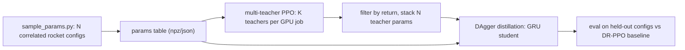

# RAPTOR recipe for the miniDropper rocket (JAX + Brax PPO + MuJoCo)

Goal: reproduce RAPTOR's "many specialised teachers -> one recurrent student" recipe for a
tethered, thrust-vector-controlled mini rocket, using the ArcDrone framework style
(MuJoCo Playground `MjxEnv` + Brax PPO + Hydra + WandB + `brax.io.model` checkpoints).
The policy tracks a **velocity reference (3D) + absolute yaw** from state-estimator inputs only
(no position anywhere).

---

## 0. Decision: port the recipe, do not reuse the RAPTOR pipeline

RAPTOR's training code (`raptor/rl-tools/src/foundation_policy/`) sits on the C++ L2F
multirotor environment (`rl-tools/include/rl_tools/rl/environments/l2f/`). That environment is
a hand-written RK4 quadrotor model: 4 rotor positions, 4 thrust curves, and a 4-D action.
It does not use MuJoCo. Swapping in a rocket would mean writing a new templated C++
environment, observation types and parameter sampler, and we would get none of MuJoCo, JAX or
Brax in return. **Verdict: not simpler. Port the *recipe* to JAX instead.** The parts that
matter are small and well defined:

- `pre_training/sample_dynamics_parameters.cpp` + `l2f/operations_generic/10_sample_initial_parameters.h`
  -> correlated parameter sampling (T/W, mass-size scaling, torque-to-inertia, motor tau, disturbances).
- `pre_training/config.h`, `pre_training/environment.h` -> one teacher per **fixed** config;
  small MLP; teacher obs = deployable obs + privileged motor state.
- `post_training/config.h`, `post_training/main.cpp` -> GRU student (hidden 16), MSE on
  deterministic teacher actions, 10 epochs of teacher-forced behaviour cloning, then on-policy DAgger
  (student acts, teacher labels), episodes shuffled across all teachers, full-episode BPTT.
- Teacher filtering: RAPTOR aborts if any teacher's `returns_mean < 300`
  (`checkpoints_*.txt` is sorted by return).

What differs from RAPTOR on purpose:
- Teachers use **PPO**, not SAC, and are trained **K at a time on the GPU** (vmapped).
- The system is under-actuated, so there are only two tracking targets: velocity and yaw.
  Attitude comes out implicitly.
- The dynamics are rocket/TVC-specific (see section 2).



---

## 1. Project layout (mirrors ArcDrone)

Root: `260926_miniDropperRL/mjo/` (next to `docs/`).

```
mjo/
  pyproject.toml                 # same stack as arcdrone minus jax-gsplat
  assets/minidropper/
    rocket.xml                   # vehicle
    scene.xml                    # floor + light + include rocket.xml
  src/minidropper/
    common/networks.py           # MLP (copied from arcdrone), GRU student
    task/
      rocket_env.py              # MinidropperRocket(MjxEnv)
      dynamics.py                # RocketParams pytree, EDF + servo models, disturbances
      commands.py                # velocity/yaw command generator
      obs.py  reward.py          # same split as arcdrone priviledged_landing_rl/task
    dr/sample_params.py          # RAPTOR-style correlated sampler -> params table
    teachers/
      cfg/config.yaml            # Hydra (env + train blocks, like arcdrone)
      train_single.py            # stock brax PPO, nominal/one config (de-risking + baseline)
      train_multi.py             # multi-teacher entrypoint (loops over chunks)
      training/multi_ppo.py      # COPY of brax/training/agents/ppo/train.py, modified
      training/networks.py       # copied from arcdrone priviledged_landing_rl/training/networks.py
    student/
      cfg/config.yaml
      train.py                   # DAgger entrypoint
      training/dagger.py         # rollout / relabel / BPTT loop
    evaluate.py                  # gui | batch (held-out configs) | nominal
  tools/viewer.py                # MuJoCo viewer (copy of arcdrone tools/mujoco_viewer.py)
```

Dependencies are pinned as in ArcDrone: jax 0.6.2, brax 0.14.x, mujoco/mjx 3.6.0,
mujoco_playground at commit `d43c721`, hydra-core, omegaconf, ml-collections, wandb.
Physics impl: **`jax` (MJX)**, not warp. The model is tiny and has no rich contacts, and
MJX supports per-env model batching (`in_axes`) and nested vmap cleanly, which multi-teacher
training needs. We can try warp later if it is faster.

Brax policy: same as ArcDrone. We copy only the file we change (`ppo/train.py`) into the
project and import everything else (`losses.py`, `acting.py`, `gradients.py`, networks) from
upstream brax. No brax fork.

---

## 2. MuJoCo model (`assets/minidropper/rocket.xml`)

Placeholder until the CAD export arrives. The kinematic tree matches the real vehicle:
- A free body `rocket` (the tube and electronics).
- The two EDFs are rigid inside the tube. Their reaction torques act on the body.
- A 2-DoF nozzle tube below them: `nozzle_pitch` hinge (y), then `nozzle_roll` hinge (x),
  each driven by a `position` actuator (the servos).
- Thrust acts at the nozzle exit along the nozzle axis, so gimballing redirects it.

Nominal values:
- mass 0.40 kg (sampled 0.20-0.70)
- diameter 0.06 m, height 0.20 m
- inertia of a solid cylinder: Ixx = Iyy = m(3r^2+h^2)/12 ~ 1.4e-3, Izz = m r^2/2 ~ 1.8e-4
- CoM ~0.09 m above the gimbal pivot
- gimbal range +-15 deg
- maximum total thrust ~2x weight

```xml
<mujoco model="minidropper">
  <compiler autolimits="true" angle="radian"/>
  <option timestep="0.002" gravity="0 0 -9.81" density="1.225" viscosity="1.8e-5"/>
  <worldbody>
    <body name="rocket" pos="0 0 1.0">
      <freejoint/>
      <!-- tube + electronics; inertial overridden by DR -->
      <inertial pos="0 0 0" mass="0.38" diaginertia="1.4e-3 1.4e-3 1.8e-4"/>
      <geom name="tube" type="cylinder" size="0.03 0.10" rgba="0.8 0.8 0.8 1" mass="0"/>
      <site name="imu" pos="0 0 0.02"/>
      <site name="edf" pos="0 0 -0.03"/>          <!-- reaction torque of both EDFs -->
      <body name="gimbal" pos="0 0 -0.09">         <!-- pivot below CoM -->
        <joint name="nozzle_pitch" type="hinge" axis="0 1 0" range="-0.26 0.26" damping="1e-4"/>
        <inertial pos="0 0 0" mass="0.005" diaginertia="1e-7 1e-7 1e-7"/>
        <body name="nozzle">
          <joint name="nozzle_roll" type="hinge" axis="1 0 0" range="-0.26 0.26" damping="1e-4"/>
          <inertial pos="0 0 -0.01" mass="0.01" diaginertia="1e-6 1e-6 1e-7"/>
          <geom type="cylinder" size="0.025 0.015" pos="0 0 -0.015" mass="0" contype="0" conaffinity="0"/>
          <site name="thrust" pos="0 0 -0.03"/>    <!-- +z of nozzle frame = thrust direction -->
        </body>
      </body>
    </body>
  </worldbody>
  <actuator>
    <!-- ctrl in Newtons / Nm: the env computes them from EDF commands (dynamics.py) -->
    <motor name="thrust"     site="thrust" gear="0 0 1 0 0 0" ctrlrange="0 15"/>
    <motor name="yaw_torque" site="edf"    gear="0 0 0 0 0 1" ctrlrange="-0.2 0.2"/>
    <position name="servo_pitch" joint="nozzle_pitch" kp="0.5" ctrlrange="-0.26 0.26"/>
    <position name="servo_roll"  joint="nozzle_roll"  kp="0.5" ctrlrange="-0.26 0.26"/>
  </actuator>
  <sensor>
    <framequat     name="quat"   objtype="site" objname="imu"/>
    <gyro          name="gyro"   site="imu"/>
    <accelerometer name="accel"  site="imu"/>
    <framelinvel   name="linvel" objtype="site" objname="imu"/>
    <jointpos      name="servo_pitch_pos" joint="nozzle_pitch"/>
    <jointpos      name="servo_roll_pos"  joint="nozzle_roll"/>
  </sensor>
</mujoco>
```

Actuator mapping, done in `dynamics.py` so that everything randomized lives in one pytree:
- Policy action `a in [-1,1]^4 = [edf_top, edf_bottom, servo_pitch, servo_roll]`.
  These are the real actuators, as requested.
- EDF i: command `u_i = (a_i+1)/2`. The state `w_i` follows `u_i` through a first-order lag,
  with separate rising and falling time constants (as in RAPTOR).
- Thrust: `T_i = T_max_i * (c1*w_i + c2*w_i^2)`.
- `ctrl[thrust] = eta(delta) * (T_1 + T_2)`, where `eta` is a deflection-efficiency loss.
- `ctrl[yaw_torque] = k_Q*(T_1 - T_2) + tau_yaw_bias + tether_torsion(yaw)`.
- Servos: the command goes through a latency buffer and a rate limit
  (smallest micro servos: ~0.08-0.12 s per 60 deg), plus a trim offset. The result is the
  position-actuator target.

---

## 3. Environment (`task/rocket_env.py`)

This follows ArcDrone `priviledged_landing_rl/task/arcdrone.py`: a `reset`/`step` pair,
`scale_action`, and helpers split into `obs.py`, `reward.py` and `commands.py`.

- Timing: `sim_dt=0.002`, `ctrl_dt=0.01` (100 Hz, same as RAPTOR), `n_substeps=5`.
  Episodes are 500 steps (5 s).
- `state.info` holds:
  - `params`: this env's `RocketParams`, which stay fixed for the whole episode.
  - EDF states `w`, servo command buffers, action history.
  - The command: `v_ref` (3), `yaw_ref`.
  - Disturbance state (tether force, gust Ornstein-Uhlenbeck (OU) process).
- Model-level parameters are injected through the playground wrapper's `randomization_fn`
  hook, which returns `(batched_model, in_axes)`. Instead of random draws, it sets them from
  the teacher table deterministically: `env j -> teacher j // E`. These are mass, inertia,
  CoM offset, gimbal pivot position, servo kp and damping.
- Initial state: in the air at 1 m. Tilt up to 20-30 deg, linear velocity in +-1 m/s,
  angular rate in +-2 rad/s, yaw in +-pi/2. EDFs start near hover. RAPTOR's "guidance" trick
  applies: with probability 0.1, start at rest and upright.
- Commands (`commands.py`), mirroring RAPTOR's position/Langevin mixture:
  - Hover: `v_ref = 0`, with probability 0.3.
  - Piecewise-constant steps, resampled every 1-2.5 s.
  - Smooth OU velocity commands.
  - Ranges: horizontal `|v| <= 1.0 m/s`, vertical `+-0.5 m/s`.
  - `yaw_ref`: an absolute angle in `+-pi/2` (bounded because of the tether), stepped or held.
- Termination: tilt > 60 deg, `|omega| > 20 rad/s`, `|v| > 3 m/s`, or NaN.
  Termination penalty as in RAPTOR.

### Observations

Student and deployment observation, 27-D. Everything comes from the state estimator:
- `v` (world frame, 3) and `v_ref` (3), or equivalently the error `v - v_ref` plus `v`
- rotation matrix R (9). RAPTOR uses a 9-D R; full attitude is needed for yaw.
- body angular rate (3)
- accelerometer specific force (3)
- `sin/cos(yaw - yaw_ref)` (2)
- previous action (4). RAPTOR includes action history length 1.

Teacher observation (`teacher_obs`) = student observation + privileged state:
EDF states `w` (2) and actual servo angles (2). This matches RAPTOR, where teachers see rotor
speeds but **no** dynamics parameters, because each teacher is specialised to one config.
The critic uses the same `teacher_obs`.

Observation dict keys follow ArcDrone: `policy_obs`, `value_obs`, plus `student_obs`.

### Reward (RAPTOR-style squared costs plus a constant)

```
r = C - [ w_v*|v - v_ref|^2 + w_yaw*(1 - cos(yaw - yaw_ref)) + w_tilt*tilt^2
          + w_w*|omega|^2 + w_da*|a_t - a_{t-1}| + w_a*|a - a_hover|^2 ]
```

Starting weights: `C=1.5, w_v=1.0, w_yaw=0.5, w_tilt=0.1, w_w=0.05, w_da=1.0, w_a=0.01`,
and `-100` on termination (RAPTOR `constant=1.5`, `d_action=1.0`, `orientation=0.1`).
Tune these on the nominal config first.

---

## 4. Parameter sampler (`dr/sample_params.py`)

This is a port of RAPTOR's correlated sampling strategy
(`10_sample_initial_parameters.h`). Order: sample T/W -> sample mass (uniform in size, with
mass proportional to size^3) -> scale geometry with size plus reciprocal-normal noise ->
derive inertia and lever arm -> sample actuator dynamics -> sample disturbances.
Output: `params_<run>.npz` plus one JSON per config (like RAPTOR's
`dynamics_parameters_*/i.json`), and a held-out test split.

The RAPTOR-to-rocket mapping below lists each rocket parameter with its sampling range
and the RAPTOR parameter it corresponds to:
- Mass: 0.20-0.70 kg, uniform in cube root. RAPTOR: mass 0.02-5.0 kg.
- Size factor (length and diameter): reciprocal-normal around mass^(1/3), deviation 0.1.
  RAPTOR: `mass_size_deviation=0.1`.
- Inertia: cylinder formula times a factor in 0.7-1.4, Izz sampled independently.
  RAPTOR: inertia factor.
- Gimbal-pivot-to-CoM lever arm: 0.05-0.14 m. RAPTOR: rotor distance / arm length.
- Lateral CoM offset: +-3 mm. No RAPTOR equivalent (a rocket-specific bias).
- Thrust-to-weight: 1.3-3.0. RAPTOR: 1.5-5.0.
- Thrust curve shape `c2/(c1+c2)`: 0.5-1.0. RAPTOR: thrust polynomial.
- Asymmetry between the upper and lower EDF (the lower one sits in the upper one's wake):
  T_max ratio 0.8-1.1. No RAPTOR equivalent.
- Torque constant `k_Q` (yaw torque per N of thrust difference): 0.005-0.05 m.
  RAPTOR: `rotor_torque_constant` 0.005-0.05.
- Yaw torque bias (residual swirl): +-5% of the yaw authority. No RAPTOR equivalent.
- EDF time constants: rising 0.02-0.10 s, falling 0.03-0.25 s. RAPTOR: rising 0.03-0.10,
  falling 0.03-0.30.
- Maximum servo angle: 10-20 deg. No RAPTOR equivalent (actuator authority).
- Servo rate: 250-750 deg/s. Servo lag / kp: 0.01-0.05 s equivalent. Servo trim offset:
  +-2 deg per axis. No RAPTOR equivalent.
- Deflection efficiency `eta`: `cos(delta)^p`, p in 1-3. No RAPTOR equivalent.
- Action / observation latency: 0-2 control steps. RAPTOR: angular-velocity delay
  (off there, but cheap here).
- Tether: constant force 0-0.3 N (random direction, biased downward), yaw torsion
  0-0.01 Nm/rad. RAPTOR: `disturbance_force_max=0.3`, as surplus-T/W-relative std.
- Random force: OU process, std up to 0.3 x (T/W - 1) x m g / 3. RAPTOR: the same formula.
- Aerodynamic drag coefficient: 0-0.3 x nominal. No RAPTOR equivalent.
- Observation noise: 0 at first, added later. RAPTOR: 0 in all 1000 configs.

Also check that each sampled config can hover (minimum T/W, and servo authority enough to
reject the CoM offset), and resample any config that cannot.

---

## 5. Stage A: single-teacher PPO sanity (`teachers/train_single.py`)

This is an almost verbatim copy of ArcDrone `priviledged_landing_rl/train.py`: stock
`brax.training.agents.ppo.train` with `wrap_for_brax_training`, a custom `make_ppo_networks`,
the WandB progress fn, and `brax.io.model.save_params`.
1. Train on the **nominal** config until velocity and yaw tracking are clean. Use this run to
   tune the reward and the command ranges.
2. The same script with `randomization_fn` sampling the **whole** distribution each episode
   gives the **classic domain-randomisation (DR) baseline**, to test your hypothesis later.
   Train both an MLP and an MLP with observation history, and give them the same total env
   steps as the student pipeline.

Teacher network, as in RAPTOR: small actor MLP (3 x 64) and critic MLP (3 x 256).
Starting PPO hyperparameters come from the ArcDrone YAML (`discounting 0.97->0.99`,
`lr 3e-4`, `ADAPTIVE_KL`), then get tuned.

---

## 6. Stage B: multi-teacher PPO (`teachers/training/multi_ppo.py`)

Copy `brax/training/agents/ppo/train.py` (brax 0.14.x) and make these changes. It is the same
workflow as `arcdrone/vision_landing_rl/training/train.py`: copy the file, patch it, and
import the rest from upstream.

1. **Env batch** = `K * E` envs (for example K=128 teachers x E=256 envs = 32k envs).
   The model is batched per env via `randomization_fn` from the teacher table.
   Env j belongs to teacher `j // E`.
2. **Training state** gets a leading axis K: `jax.vmap(init)` over K keys for
   policy/value params, optimizer state and the observation normaliser (each teacher has its
   own running statistics).
3. **Acting**: the policy fn passed to `acting.generate_unroll` reshapes obs to `(K, E, ...)`
   and `vmap`s `make_policy` over the stacked params, then flattens back. The physics is
   never double-vmapped.
4. **Learning**: reshape the rollout data `(T, K*E, ...) -> (K, T, E, ...)` and `jax.vmap`
   the existing `training_epoch` / `sgd_step` / minibatch logic over K. `losses.py` is
   unchanged. The ADAPTIVE_KL learning rate becomes per-teacher (it lives in the vmapped
   optimizer state).
5. **Eval and metrics**: return per-teacher episode return and length arrays
   (logged to WandB as a histogram + mean/min).
6. **Checkpoint**: save one pkl per chunk: `{teacher_ids, stacked_params, normalizer, returns}`.

`train_multi.py` loops over chunks `N / K` (for example 1000 configs = 8 chunks of 128) and
writes `teachers/<run>/chunk_XX.pkl` plus a `teachers_index.csv` sorted by return,
like RAPTOR's `extract_checkpoints.sh`.

Filtering: drop teachers below a return threshold, or with a termination rate above x%.
If the drop rate is high, resample those configs and retrain.

VRAM budget (RTX 5060 Ti, 16 GB): with state-only observations and a 4-body model, 32k MJX
envs should fit. Use `XLA_PYTHON_CLIENT_PREALLOCATE=false`, and lower K or E if it does not.
Start with K=8 to check that the result matches the single-teacher run on the same config.

---

## 7. Stage C: GRU student via DAgger (`student/`)

ArcDrone has no recurrent policies, so this part is new. The loop structure (beta schedule,
collect -> align) follows `arcdrone/vision_landing_dagger/training/train.py`, simplified:
there is no vision and no feature alignment, only action MSE, as in RAPTOR.

- Student network (`common/networks.py`): Dense(64, relu) -> GRU(64) -> Dense(4, tanh),
  input = `student_obs` (27-D). RAPTOR uses hidden 16; we start at 64 and shrink later for
  the flight computer. Observation normalisation stats are frozen from the teacher rollouts.
- Teachers: stack all N accepted teacher params (a 3 x 64 MLP is ~10k params, so 1000
  teachers is ~10M floats) and `vmap` the deterministic action (the tanh of the mean)
  over teachers, with obs reshaped to `(N, E_s, ...)`.
- Envs: N teachers x E_s envs (for example 1000 x 16 = 16k). Each env gets its teacher's
  config through the same `randomization_fn` table.
- Loop (RAPTOR `post_training/main.cpp`):
  - Epochs 0-9: the teacher acts (teacher forcing) and the student learns from teacher
    labels.
  - Epoch 10 onward: the **student acts**, on-policy DAgger (`ON_POLICY`, the dataset is
    reset every epoch). Every visited state is labelled by that env's teacher.
    An optional short beta ramp replaces the hard switch.
  - Loss: MSE(student action, teacher deterministic action) over full 500-step episodes.
    The GRU state resets at episode start. Truncated BPTT over 100-step chunks with a burn-in
    is available if memory requires it.
  - Episodes are shuffled across teachers into minibatches of 64-256 sequences. Adam, lr 1e-4.
  - Each epoch, evaluate the mean return, termination rate and velocity/yaw root-mean-square
    (RMS) error over (a) the training configs, (b) the held-out configs, (c) the nominal
    config. Keep the best checkpoint.
- Save with `brax.io.model.save_params` (`student_best.pkl`).

---

## 8. Evaluation (`evaluate.py`)

- Modes:
  - `gui`: MuJoCo viewer with keyboard velocity/yaw commands (for the user). Primitive
    rocket, plus drawn nozzle, thrust flame and velocity/yaw arrows.
  - `batch`: many episodes on held-out configs. With `--ai`, it dumps the full diagnostics
    for agent-driven tuning. (No `stress` mode: dropped on request.)
- Headline comparison, to test your hypothesis: GRU student vs the DR-PPO baselines from
  Stage A, with matched env-step budgets. Metrics: tracking RMS, termination rate, and the
  worst 5% of configs.
- Flight-computer export is postponed (see "After Building").

---

## 9. Milestones / order of work

1. Scaffold `mjo/` (pyproject, package, Hydra cfg), write `rocket.xml` and `scene.xml`, and
   check in the viewer: hover trim, gimbal step response, yaw from differential thrust.
2. `rocket_env.py` + `dynamics.py` + `commands.py` + `obs.py` + `reward.py` on the nominal
   config. Unit-test open-loop physics (hover thrust = m g, torque signs).
3. Stage A: nominal PPO teacher tracks velocity and yaw. Tune the reward.
4. `sample_params.py` + feasibility checks. Visualise the parameter histograms.
5. Stage B: `multi_ppo.py`. Validate K=8 against single-teacher runs, then scale K and train
   all chunks, filter, and write the index.
6. Stage C: GRU student + DAgger. Validate on held-out configs.
7. DR-PPO baseline and head-to-head evaluation. Swap in the CAD-derived MJCF when available
   and re-centre the sampler ranges on it.

---

## 10. As built (first build, 2026-09-29)

This section records how the build differs from the plan above:
- **Repository.** The code lives in `miniDropper_RL/` (the GitHub repo). The old
  `260926_miniDropperRL/` folder is legacy. The package is `src/minidropper/`.
- **Physics.** The rocket is a single free body with contacts disabled.
  - Thrust (at the gimbal pivot, along the nozzle direction), EDF reaction torque,
    swirl bias, drag, tether pull, tether torsion and the OU gust force are computed in
    `task/dynamics.py`. They are applied through `data.xfrc_applied` at every physics
    substep, instead of MuJoCo actuators.
  - Servos and EDFs are modelled in the env: first-order lag with separate rise and fall
    time constants for the EDFs, and lag plus slew-rate limit plus trim for the servos.
  - This avoids stiff, near-massless gimbal joints. The GUI draws the nozzle and the
    thrust vector.
  - Mass and inertia are swapped per env in the MJX model; everything else lives in the
    `RocketParams` pytree.
- **Lateral CoM offset.** The sampling range is widened to 0-12 mm (the note on asymmetric
  servo placement). It is bounded by the feasibility check: the trim angle must stay below
  half the servo range.
- **Brax / Playground copies** (the ArcDrone copy-and-patch style, no fork):
  - `teachers/training/ppo_train.py`: brax 0.14.2 PPO patched for jax 0.11
    (`device_put_replicated` was removed).
  - `task/wrapper.py`:
    - `ConfigVmapWrapper`: the playground DR wrapper, also swapping `RocketParams`.
    - A fixed `BraxAutoResetWrapper`: with `full_reset=True` the playground version also
      reset `truncation` and the episode statistics. That made PPO treat every time-out as
      a crash.
  - `teachers/training/multi_ppo.py`: the multi-teacher trainer, derived from brax PPO.
- **Observation history.** It is off by default (`env.obs_history=1`) to save VRAM in
  multi-teacher training. Turn it on only for the MLP+history DR baseline.
- **Student.** Dense(64, relu), then GRU(64), then Dense(4, tanh). Observation
  normalisation is frozen from the first (teacher-forced) epoch. Steps after a termination
  are masked out of the loss.
- **Overfitting curve.** 10% of the accepted teachers are held out. The logs report
  `train/loss` (imitation on training teachers) against `val/imitation_mse` (the student
  flying the held-out teachers' configs, labelled by those teachers), plus
  `val/return` and `test/return` (held-out test split, no teacher). For the DR baseline, the
  eval env uses the held-out test split, so `[train]` versus `[eval]` returns give the
  equivalent generalisation curve.
- **Logging.** Every trainer writes `metrics.jsonl` in its Hydra dir. WandB is off
  (`use_wandb: false`).

Measured timing (RTX 5060 Ti 16 GB):
- Multi-teacher PPO: ~1.35 M env steps/s total at K=128 x 128 envs, using 4.9 GB VRAM.
  K=256 is not faster (1.29 M steps/s, 8.3 GB).
- 1000 teachers x 30 M steps is about 6 h (10 M steps: 2 h).
- DAgger at 16k envs: 8.5 s per epoch, so 1000 epochs is about 2.4 h.
- Nominal single PPO teacher: 30 M steps in 2.5 min, reaching 0.4% terminations and
  0.26 m/s mean velocity error.

End-to-end smoke run (`outputs/e2e/`):
- **Teachers:** 64 teachers x 10 M steps in 9.3 min. 24/64 were accepted. The best teacher
  on its own config gets return +675, 0% terminations, 0.25 m/s velocity error and 17 deg
  yaw error.
- **Student:** 60 DAgger epochs on 22 training teachers plus 2 held out, in 63 s. It is
  still improving steeply: val/return went from -170 to +152 and val/terminated from 1.0
  to 0.5.
- **Student on the test split:** 93% terminations. This is expected at this size; it only
  shows the pipeline works, not that the student is good.

## 11. After Building (open items / left for later)

Things to test or tune (the second task: iterate on training):
- **Teacher budget and quality.** With 6 M steps per teacher, only ~40% passed the
  acceptance threshold. The nominal teacher needed ~30 M steps with a large batch. To do:
  - Tune the per-teacher PPO settings: envs per teacher, unroll length, minibatches,
    entropy, desired KL.
  - Check which configs fail, using `evaluate --ai` param-vs-return correlations.
  - Decide whether hard configs are unsolvable (then tighten the sampler) or under-trained.
- **Acceptance threshold** (`accept_min_return=400`, `accept_max_terminated=0.05`). This is
  RAPTOR's `SOLVED_RETURN`, rescaled; it needs calibration once teachers are good.
- **Reward weights** and termination limits (tilt 1.2 rad, |omega| 25 rad/s, velocity
  error 3 m/s). The command ranges and rates (|v_xy| 1 m/s, |v_z| 0.5 m/s, yaw ±1.5 rad)
  should be matched to what the real tether allows.
- **Parameter ranges** need re-centring on the CAD model once it exists: mass, inertia,
  pivot-to-CoM, EDF thrust curve and time constants, servo speed and range, tether force
  and torsion. The sampler currently rejects ~20% of samples as infeasible.
- **Student.** Hidden size, number of epochs (RAPTOR: 1000), a beta ramp instead of the hard
  switch, and more envs per teacher. Check how val/imitation_mse tracks test/return.
- **The headline experiment**: GRU student vs DR-PPO (MLP) vs DR-PPO (MLP + history), with
  matched env-step budgets, on the held-out split. A recurrent PPO baseline (GRU inside
  PPO) would need a new trainer; not done.
- **Observation noise and latency** on observations. The sampler only randomises action
  latency; RAPTOR also had zero observation noise. Add IMU / state-estimator noise before
  going to hardware.
- **Speed.** Env stepping is ~2.8 M steps/s alone, versus ~1.35 M steps/s inside PPO.
  Options:
  - Cheaper full reset (it runs every step).
  - Fewer substeps (`sim_dt` 0.002 to 0.005).
  - Passing the config table as a jit argument instead of a closure constant, which
    would avoid a recompile per chunk (~30-60 s).
- **Online parameter tweaking in the GUI.** Not added (it was not trivial with the passive
  viewer). Possible later with a small Tk / ImGui side panel that rewrites the `RocketParams`
  row and rebuilds the jitted step.
- **Flight-computer export** of the student (ONNX, or a hand-written C GRU). Postponed:
  deployment starts on the laptop GPU over the tether, and a companion computer comes
  later.
- **CAD MJCF.** Replace `assets/minidropper/rocket.xml`, keeping the body name `rocket` and
  the CoM at the body origin, or set `body_ipos`.
- **Commit** `data/params/v1.npz` (small) so the runs are reproducible.
